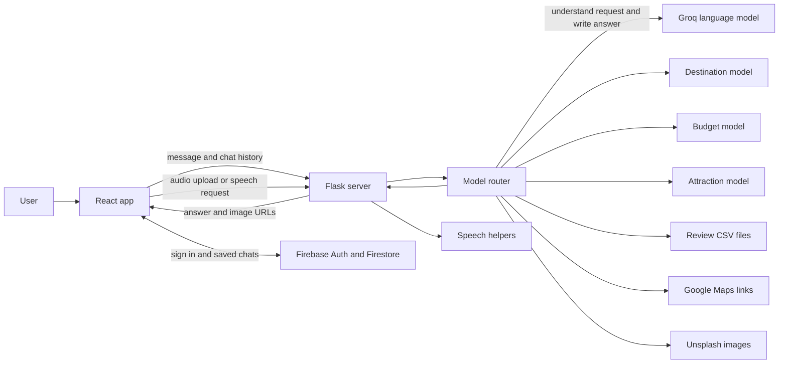

# Traivo

Traivo is a travel planning chatbot made as a college project. It helps people explore destinations, get travel suggestions, read a short summary of positive and negative reviews, estimate a trip budget, find attractions, open those places in Google Maps, view travel images, and use voice input or speech output.

The project has two parts. The React app runs in the browser. The Python server receives chat messages, calls Groq when language understanding is useful, and connects the conversation to the project's local machine learning models and travel data.

## What happens when someone sends a message

1. The React app adds the user's message to the current chat and sends the latest message and conversation history to the Python server.
2. The Flask route in `backend/app.py` passes them to `backend/model_router.py`.
3. The router asks Groq to interpret the request when needed. It can extract travel preferences, trip details, or image requests.
4. Local Python code uses the saved PKL models to recommend destinations, estimate a budget, or rank attractions. Review summaries are made by Groq from the review CSV files.
5. The router combines the useful results into one response. It can also add Google Maps links and Unsplash image URLs.
6. The server returns the response and any selected images as JSON. React displays the answer in the chat.

The browser keeps the active chat in memory while the page is open. A refresh clears that temporary state. Signed in users can also save and load chats with Firebase Firestore. The Python server does not receive Firebase credentials or write to Firestore.

## Architecture diagram

This diagram shows the main request path and the services used by each part of the app.



Groq handles language tasks, while the destination, budget, and attraction models run in Python using their saved model files. Firebase is used directly by the browser for sign in and saved chat history.

## Project layout

The main application code is in `backend` and `frontend/traivo`. Folders such as `node_modules`, Python `__pycache__`, and React `build` are generated files. They are not source code and do not need to be edited by hand.

## Backend files

### Server and request routing

- `backend/app.py` creates the Flask server and defines the chat, audio upload, speech to text, and text to speech routes.
- `backend/model_router.py` is the main travel request coordinator. It calls Groq, the local models, the review summarizer, the Google Maps helper, and the image search code. It reads `GROQ_API_KEY` and the optional `UNSPLASH_API` from the backend environment file.
- `backend/.env` is for private local keys. Keep real keys out of Git and do not share this file. `GROQ_API_KEY` is required for Groq features. `UNSPLASH_API` is optional and is needed for Unsplash images.

### Backend helpers

- `backend/features/google_maps.py` builds a Google Maps search URL for an attraction and destination.
- `backend/features/tts.py` handles text to speech and speech recognition. Speech recognition uses Google's online recognition service. Audio conversion uses pydub and may need FFmpeg installed.
- `backend/features/recordings` is where uploaded audio is expected to be saved while speech recognition runs. The folder must exist for audio upload to work.

### Data files

- `backend/data_processing/traivo_destination_knn_training.csv` contains the destination rows used by the destination recommender.
- `backend/data_processing/traivo_destination_knn_testing.csv` is a separate destination testing dataset. The current destination notebook reports its score using a random split of the training CSV instead.
- `backend/data_processing/traivo_budget_prediction_dataset.csv` contains examples used to train the budget model.
- `backend/data_processing/traivo_attractions.csv` contains attraction names and details used by the attraction recommender.
- `backend/data_processing/traivo_travel_customer_reviews.csv` contains review records used to prepare review data. The notebook identifies 29,700 rows and includes an `is_synthetic` field.
- `backend/data_processing/Hotel_Reviews.csv` is a hotel review dataset kept with the project. The chatbot's current review summarizer reads the prepared positive and negative CSV files described below.
- `backend/data_processing/customer_reviews_datapreprocessing.ipynb` is a notebook for checking the customer review data, its columns, destinations, and missing values.
- `backend/data_processing/data_check.ipynb` is an older exploratory notebook. It refers to files under `backend/raw_data` that are not included in the current project, so it is not needed to run the app.

### Models and training files

- `backend/model_build/main_model.py` loads the destination KNN model and vectorizer, scores destinations against five preferences, and returns the top three.
- `backend/model_build/main_model.pkl` is the trained destination KNN model.
- `backend/model_build/vectorizer.pkl` converts destination and preference fields into numeric features for that model.
- `backend/model_build/main_model.ipynb` prepares and evaluates the destination recommender, then saves the model files. It uses five preference fields and reports 0.958 accuracy on its random held out split.
- `backend/model_build/budget_model.py` loads the saved budget model, creates one row from trip details, and returns a nonnegative rounded estimate.
- `backend/model_build/budget_model.pkl` is the trained budget prediction pipeline.
- `backend/model_build/budget_model.ipynb` trains and evaluates the budget model from the budget CSV.
- `backend/model_build/attraction_model.py` loads the attraction model, filters attractions by destination and request details, then returns up to three ranked results.
- `backend/model_build/attraction_model.pkl` is the saved attraction ranking model and its vectorizer.
- `backend/model_build/attraction_model.ipynb` documents the attraction data preparation and model evaluation.
- `backend/model_build/train_attraction_model.py` is the Python script version of attraction model training. Run it from the backend directory so its relative data path resolves.
- `backend/model_build/review_summarizer.py` selects reviews for a destination and asks Groq to summarize the supplied positive or negative text. It does not load a trained review model.
- `backend/model_build/positive_reviews.csv` contains prepared positive reviews used by the summarizer.
- `backend/model_build/negative_reviews.csv` contains prepared negative reviews used by the summarizer.
- `backend/model_build/positive_reviews.pkl` is an export created during review data preparation. The live summarizer currently reads the CSV files instead.
- `backend/model_build/train_summarizer.ipynb` prepares and checks the review data. It reports 9,900 positive reviews and 30 destinations, and saves the positive review pickle.

## How the models work

### Destination suggestions

The destination model is a K nearest neighbors classifier. It compares five user preferences with destination features: budget, group type, vibe, climate, and continent. A DictVectorizer converts those fields into model features. The application scores destination rows and shows the three highest ranked results.

The training notebook uses 376,320 rows and 16 columns in the destination CSV. It uses a random 80 percent training and 20 percent test split. The reported accuracy is 0.958 on that split. This is a notebook result, not a guarantee that every suggestion will be correct. The separate testing CSV is not used for that reported score in the current notebook.

### Budget estimate

The budget model is linear regression with one hot encoding for the categorical trip details. It predicts total trip cost from destination, traveller count, trip length, travel style, season demand, activity level, accommodation type, and whether travel is domestic or international. The target is transformed with log1p during training and converted back with expm1 for the estimate.

The notebook reports an R squared score of 0.933, a mean absolute error of INR 43,085.16, and a root mean squared error of INR 97,405.02 on its held out test data. Those error values are large enough that the result should be treated as a broad estimate, not a quote or a precise budget. The current chat fills in defaults for trip details the user did not provide.

### Attraction suggestions

The attraction model ranks rows from the curated attraction CSV. The training code expands attraction details into combinations of vibe, budget, and visit time. It uses a DictVectorizer and a K nearest neighbors classifier. At request time the app first filters by destination and selected details, then sorts the remaining rows by model score and returns up to three. The notebook uses an 80 percent and 20 percent split, but its saved output does not record a clear accuracy value. This README therefore does not claim a numeric attraction accuracy.

### Review summaries

The review summarizer is not a locally trained model. It finds the positive or negative review text for a destination in the prepared CSV files and sends a limited amount of that text to Groq. Groq is instructed to summarize only the supplied evidence. If a destination has no matching rows, the helper says that no reviews were found in the data.

## Groq model and token values

The backend currently requests the Groq hosted model `openai/gpt-oss-120b`. Groq is used to understand natural language, extract details, summarize review text, decide if images would help, and write conversational answers. It does not replace the local PKL recommenders or the budget model.

The code sets these `max_completion_tokens` limits for different calls:

- Preference extraction: 300
- Budget detail extraction: 200
- Attraction detail extraction: 150
- Image decision: 200
- Each review summary: 250
- General chat response: 500
- Destination and review response: 600

These numbers are maximum completion limits for individual calls. They are not the number of tokens every request will use, and they do not include a fixed bill amount. Actual use depends on the prompt, conversation history, and response. The `reasoning_effort` setting is low for several calls. Check the Groq account and current model documentation for current pricing and limits.

## Frontend files

### Main React files

- `frontend/traivo/src/index.js` starts the React application and loads the global styles.
- `frontend/traivo/src/App.js` sets up the application routes.
- `frontend/traivo/src/Layout.jsx` provides the shared page layout around routed pages.
- `frontend/traivo/src/Components/Home.jsx` manages the chat view, current messages, sending prompts, loading chat history, and starting a new chat.
- `frontend/traivo/src/Components/InputBar.jsx` provides the prompt input and send controls.
- `frontend/traivo/src/Components/OutputPlain.jsx` displays the conversation output area.
- `frontend/traivo/src/Components/SideBar.jsx` displays the chat history and new chat control.
- `frontend/traivo/src/Components/Navbar.jsx` displays the main navigation bar.
- `frontend/traivo/src/Components/AccountSideBar.jsx` provides account, sign in, sign out, and settings controls.
- `frontend/traivo/src/Components/About.jsx` displays the project information and architecture explanation.
- `frontend/traivo/src/Components/Messages/UserInput.jsx` displays a user message.
- `frontend/traivo/src/Components/Messages/ChatOutput.jsx` displays and formats an assistant answer, along with any images and available message actions.
- `frontend/traivo/src/chatHistory.js` loads and saves a user's chat documents in Firestore.
- `frontend/traivo/src/firebase.js` initializes the Firebase client using the project's web configuration.

### Frontend styles

- `frontend/traivo/src/App.css` contains application level styles.
- `frontend/traivo/src/index.css` contains global page styles.
- `frontend/traivo/src/CSS/About.css` styles the About page.
- `frontend/traivo/src/CSS/AccountSideBar.css` styles the account and settings sidebar.
- `frontend/traivo/src/CSS/ChatOutput.css` styles assistant messages and their content.
- `frontend/traivo/src/CSS/InputBar.css` styles the chat input area.
- `frontend/traivo/src/CSS/Navbar.css` styles the navigation bar.
- `frontend/traivo/src/CSS/OutputPlain.css` styles the main conversation area.
- `frontend/traivo/src/CSS/SideBar.css` styles the chat history sidebar.
- `frontend/traivo/src/CSS/UserInput.css` styles user messages.

### Frontend setup and assets

- `frontend/traivo/package.json` lists the JavaScript packages and commands. The app uses React, React Router, Firebase, and Create React App scripts.
- `frontend/traivo/package-lock.json` records the installed dependency versions for repeatable installs.
- `frontend/traivo/firestore.rules` limits each signed in user to their own chat documents under their user ID.
- `frontend/traivo/public/index.html` is the HTML page used by the React app.
- `frontend/traivo/public/manifest.json` contains install and browser metadata.
- `frontend/traivo/public/robots.txt` gives crawler instructions.
- `frontend/traivo/public/arrow.png`, `favicon.png`, `mic.png`, `new-chat.png`, `sidebar.png`, `speaker.png`, and `user.png` are interface images and icons.
- `frontend/traivo/public/logo192.png`, `logo512.png`, `traivo-favicon.svg`, `traivo-logo.png`, and `traivo-workflow.png` are app branding and project visuals.
- `frontend/traivo/src/send.png` and `frontend/traivo/src/logo.svg` are image assets stored with the React source.
- `frontend/traivo/src/reportWebVitals.js` is the Create React App performance reporting helper.
- `frontend/traivo/src/setupTests.js` configures the default React testing utilities.
- `frontend/traivo/src/App.test.js` is the Create React App starter test. It still checks for the original starter text and may need to be updated before it reflects Traivo.
- `frontend/traivo/README.md` is the default Create React App guide. This root README is the guide for the Traivo project.
- `frontend/traivo/.gitignore` lists files Git should ignore in the frontend project.
- `frontend/traivo/app_presentation.log` is a local presentation or development log and is not needed to run the app.

## Sign in and chat history

The frontend uses Firebase Authentication for Google sign in and Firestore for saved chats. Create a Firebase project, enable Google as a sign in provider, create a Firestore database, and add the local development domain to the authorized domains. Set the Firebase web app configuration in `frontend/traivo/src/firebase.js`. Do not put private service account credentials in the browser app.

Publish the rules from `frontend/traivo/firestore.rules` in the Firebase console. The rule allows an authenticated user to read and write chats only under their own user ID. If Firebase is not configured, the frontend may still run, but sign in and cloud chat history will not work.

## Setup and start the project

You need Python, Node.js with npm, a Groq API key, and optionally an Unsplash API key. Run the backend from its own directory because some data and audio paths are relative to that directory.

### Start the backend on Windows PowerShell

Open a terminal in the project folder and run:

```powershell
cd backend
py -m venv .venv
.\.venv\Scripts\Activate.ps1
python -m pip install flask flask-cors python-dotenv groq pandas scikit-learn pyttsx3 SpeechRecognition pydub
```

Create `backend/.env` and add your keys:

```text
GROQ_API_KEY=your_groq_key
UNSPLASH_API=your_unsplash_key
```

The Unsplash line is optional. Keep the real key values private. Then start the server:

```powershell
python app.py
```

The backend runs at `http://127.0.0.1:5000`.

### Start the frontend

Open a second terminal in the project folder and run:

```powershell
cd frontend/traivo
npm install
npm start
```

The React development app opens at `http://localhost:3000` and sends requests to the backend at `http://127.0.0.1:5000`.

For speech to text, install FFmpeg and make sure it is available on your PATH so pydub can convert the uploaded WebM recording. The speech recognition request also needs an internet connection. Text to speech depends on the operating system's available voice engine.

## Available commands

Run these from `frontend/traivo`:

- `npm start` starts the development server.
- `npm run build` creates a production build in the generated `build` folder.
- `npm test` runs the React test setup. The existing starter test is not yet tailored to Traivo.
- `npm run eject` exposes Create React App configuration. This is a one way operation and is not needed for normal development.

The model notebooks are for training and evaluation, not required to serve requests. The `.pkl` files must be present for the backend to load the local models. To retrain a model, use its notebook or training script and save the output to the matching file in `backend/model_build`.

## Current project limits

- The budget estimate is only as useful as its dataset and default trip details. Its reported average test error is about INR 43,085.
- Model scores come from the evaluation splits documented above. They do not prove that the data covers every destination or travel situation.
- Review summaries depend on the prepared review CSVs and only reflect text present in those files.
- Unsplash images depend on a valid API key, network access, and results returned by Unsplash.
- Chat requests use the local backend address in the frontend source. To deploy the app, update that address to the deployed backend URL and configure production Firebase domains and rules.
- The project does not currently include a backend requirements file. The install command above lists the Python packages imported by the backend.

## People who built the project

Shreshtha Sharma worked on the frontend, connecting the frontend to the backend, and text to speech. Satwik Maurya worked on making and training the models. Abhishek Yadav worked on collecting data.
